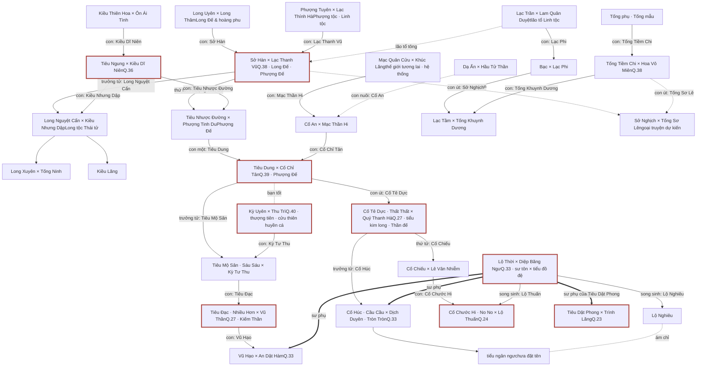
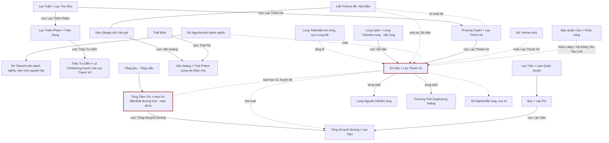
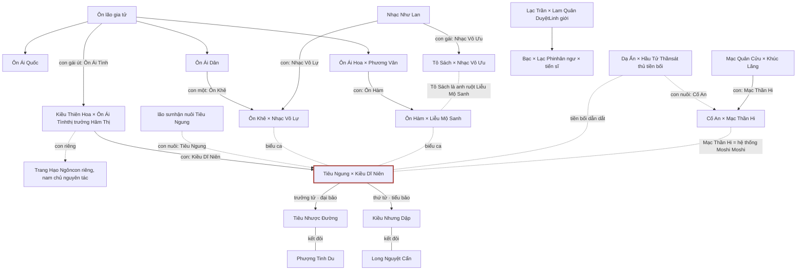
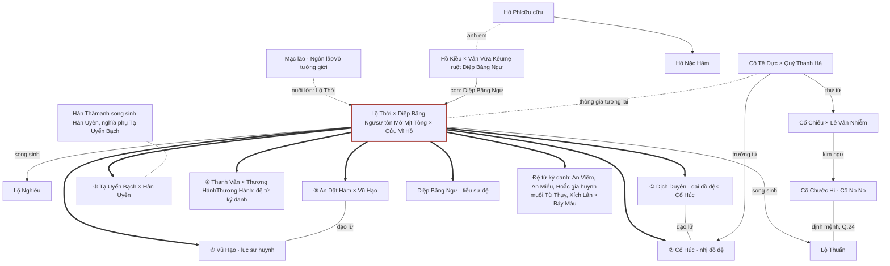
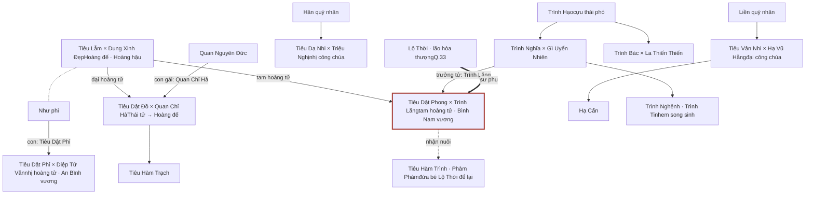
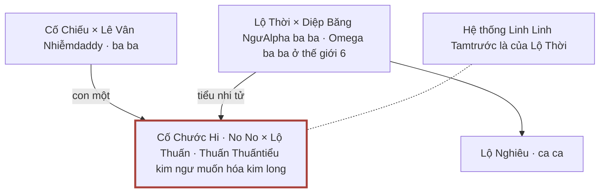
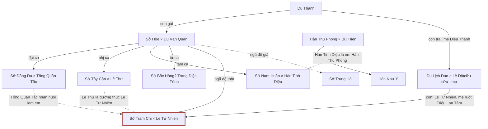
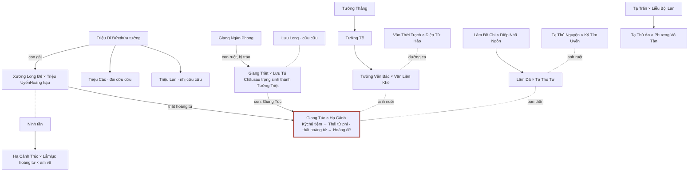

熙晴画易 · Hi Tình Họa Dịch · đam mỹ

# Gia phả và quan hệ nhân vật qua 10 bộ truyện

Phân tích từ bản convert tiếng Việt của 10 bộ truyện. Ba điểm khởi đầu Sở Hàn × Lạc Thanh Vũ, Tiêu Ngung × Kiều Dĩ Niên và Lộ Thời × Diệp Băng Ngư cuối cùng hợp thành **một đại gia tộc duy nhất** ở Thần giới. Q.23 nối vào qua sư phụ Lộ Thời; Q.25 và Q.26 là truyện độc lập.

[Thứ tự hệ liệt](#thu-tu) [Đại gia phả](#dai-gia-pha) [Nhánh Long–Phượng (Q.38)](#nhanh-38) [Nhánh Tiêu–Kiều (Q.36)](#nhanh-36) [Nhánh Lộ Thời (Q.33)](#nhanh-33) [Q.23](#q23) [Q.24](#q24) [Q.25](#q25) [Q.26](#q26) [Liên kết giữa các nhà](#lien-ket) [Biến thể tên](#ten-goi)

## Thứ tự hệ liệt theo lời tác giả

Hậu ký Q.39 và Q.27 liệt kê hệ liệt văn 1 → 5. Hậu ký Q.33 gọi nó là “bộ thứ ba đếm ngược của toàn hệ liệt”, và Q.24 là “bộ thứ hai đếm ngược”.

| Thứ tự        | Quyển | Tên truyện                                                                              | CP chính                        | CP phụ                                                                                                                                                         |
| --------------- | ------ | ----------------------------------------------------------------------------------------- | -------------------------------- | --------------------------------------------------------------------------------------------------------------------------------------------------------------- |
| Hệ liệt 1     | Q.38   | Xuyên thư: Vì cầu tự bảo vệ mình, ta liêu vai ác nghiện rồi                   | Sở Hàn × Lạc Thanh Vũ       | Tống Tiềm Chi × Hoa Vô Miên; Mạc Quân Cửu × Khúc Lăng; Triệu Tự Diễn × Lộ Tinh; Vân Hoàng × Thái Phi; Liệt Phong × Long Trạch…          |
| Hệ liệt 2     | Q.36   | Mạt thế: Nhà ta kiều khí bao không hống liền hắc hóa                            | Tiêu Ngung × Kiều Dĩ Niên   | Ôn Hàm × Liễu Mộ Sanh; Ôn Khê × Nhạc Vô Lự; Dạ Ẩn × Hầu Tử Thần; Cố An × Mạc Thần Hi; Bạc × Lạc Phi                                     |
| Hệ liệt 3     | Q.39   | Xuyên nhanh: Cố chấp tiểu đáng thương muốn hống muốn thân muốn ôm một cái | Tiêu Dung × Cố Chỉ Tân      | Tiêu Mộ Sân × Kỳ Tư Thu; Tống Ngọc Sâm × Thần Xuyên                                                                                                 |
| Hệ liệt 4     | Q.40   | Mở mắt ra, ta hôn nam chủ bạch nguyệt quang một ngụm                              | Kỳ Uyên × Thu Trì            | Hồng Tư Vũ × Lam Chương; Lam Diệc Phong × Du Trừng; Chu Trình × Trang Ngọc Thành; Lương Duệ Đạt × Lục Thanh…                               |
| Hệ liệt 5     | Q.27   | Cứu vớt vai ác biện pháp: Điên cuồng dán dán                                    | Cố Tê Dực × Quý Thanh Hà   | Tiêu Đạc × Vũ Thần                                                                                                                                        |
| Đếm ngược 3 | Q.33   | Nề hà đồ đệ quá mê người                                                        | Lộ Thời × Diệp Băng Ngư    | Cố Húc × Dịch Duyên; Vũ Hạo × An Dật Hàm; Cố Chiếu × Lê Vân Nhiễm; Tạ Uyển Bạch × Hàn Uyên; Thương Hành × Thanh Vân                  |
| Đếm ngược 2 | Q.24   | Cứu vớt tiểu pháo hôi giống như ở câu ta?                                        | Cố Chước Hi × Lộ Thuấn     | Mỗi tiểu thế giới có CP riêng (file chỉ đến ch.417, chưa hết)                                                                                        |
| Liên động    | Q.23   | Điên phê hoàng tử bị đọc tâm, hoàng thất cả nhà đều choáng váng          | Tiêu Dật Phong × Trình Lăng | Tiêu Dật Phỉ × Diệp Tử Văn                                                                                                                               |
| Độc lập      | Q.25   | Xuyên thành năm tuổi đoàn sủng, làm phiên vai ác bàn tay vàng                 | Sở Trầm Chi × Lê Tư Nhiên  | Sở Đông Du × Tống Quân Tắc; Sở Tây Cần × Lê Thư; Sở Nam Huân × Hàn Tinh Diệu; Du Lịch Dao × Lê Dật; Hàn Thu Phong × Bùi Hiên          |
| Độc lập      | Q.26   | Cửa hàng tiện lợi cổ thông nay, ta kiều dưỡng thất sủng tiểu hoàng tử       | Giang Túc × Hạ Cảnh Kỳ      | Lâm Dã × Tạ Thủ Tư; Hạ Cảnh Trúc × Lẫm; Tạ Thủ Ân × Phương Vô Tân; Tưởng Văn Bác × Vân Liên Khê; Vân Thời Trạch × Diệp Tử Hào |

Hậu ký Q.27 còn báo trước hai ngoại truyện: **Sở Nghịch × Tống Sơ Lê** (con út của Sở Hàn và con út của Tống Tiềm Chi) và một bộ liên quan Lộ Thời. Q.36 gọi truyện của Sở Hàn bằng tên khác: 《Trói định hệ thống sau, ta ở Tu chân giới câu đến vai ác》.

## Đại gia phả liên hoàn Q.38 · 36 · 39 · 40 · 27 · 33 · 24 · 23

Mỗi ô là một cặp đôi (công ghi trước). Mũi tên đi từ cha mẹ xuống cặp của con, nhãn ghi tên người con.

**──▶** con ruột**┄┄▶** con nuôi / tổ tiên xa / dự kiến**━━▶** sư phụ → đồ đệ**┄┄** ám chỉ / bạn tốt

### Các thế hệ ở Thần giới

- **Đời 1:** Sở Hàn × Lạc Thanh Vũ · Tiêu Ngung × Kiều Dĩ Niên · Tống Tiềm Chi × Hoa Vô Miên
- **Đời 2:** Long Nguyệt Cẩn × Kiều Nhưng Dập · Tiêu Nhược Đường × Phượng Tinh Du
- **Đời 3:** Tiêu Dung × Cố Chỉ Tân
- **Đời 4:** Tiêu Mộ Sân × Kỳ Tư Thu · Cố Tê Dực × Quý Thanh Hà
- **Đời 5:** Tiêu Đạc × Vũ Thần · Cố Húc × Dịch Duyên · Cố Chiếu × Lê Vân Nhiễm
- **Đời 6:** Vũ Hạo × An Dật Hàm · Cố Chước Hi × Lộ Thuấn

### Cách xưng hô chéo đã kiểm chứng

- Tiêu Dung gọi Sở Hàn, Lạc Thanh Vũ là **ông ngoại**, gọi Tiêu Ngung là **gia gia**.
- Cố Tê Dực gọi Sở Hàn là **ngoại tằng tổ phụ**.
- Tiêu Đạc gọi Cố Tê Dực là **thất thúc**; Tiêu Đạc là **đường ca** của Cố Húc.
- Vũ Hạo chào “**thất thúc công**, Thanh Hà thúc công, **Húc đường thúc**”.
- Cố Chước Hi gọi Tiêu Dung là **thái gia gia**, Sở Hàn là **lão tổ tông**.
- Cố Chước Hi gọi Lộ Thời, Diệp Băng Ngư là **nhạc phụ**.

## Nhánh Long–Phượng Q.38 · Sở Hàn × Lạc Thanh Vũ

### Các CP phụ khác trong Q.38

- Liệt Phong × Long Trạch (lam long)
- Vân Diệp × Vân Ảnh
- Thẩm Vân Vân × Lãnh Thanh Thu (bách hợp, sư tỷ muội)
- Tổ Minh Kiệt × La Y Y
- Gì Nhuận × Lộ Nguyệt
- Phì Thỏ (linh thú của Sở Hàn) × Dương Nhạc
- Liên Phi × Huyền Mặc (hai dị hỏa)

**Sư đồ:** Ôn Hành → Lãnh Thanh Thu; Tiêu Thông → Sở Tiêu.

**Khách mời:** phiên ngoại Q.38 đã có Lộ Thời, Diệp Băng Ngư và hai con, cùng Cố Chước Hi × Lộ Thuấn.

## Nhánh Tiêu–Kiều Q.36 · Tiêu Ngung × Kiều Dĩ Niên

Trong Q.36, Sở Hàn là người làm ngọc bội của nhà họ Ôn (truyền qua Ôn Ái Tình sang Kiều Dĩ Niên) và không gian của Mạc Thần Hi. Thú cưng: Tiểu Bạch (samoyed) và Đại Hắc (rắn).

## Nhánh Lộ Thời và sư môn Q.33 · Lộ Thời × Diệp Băng Ngư

Hậu ký Q.33 nói Lộ Thời đã được cài cắm từ truyện của Sở Hàn. Lộ Thời từng gặp Sở Hàn, Lạc Thanh Vũ, Tống Tiềm Chi, Hoa Vô Miên ở Tiên giới và giúp họ phi thăng Thần giới nhanh hơn. Hệ thống của Lộ Thời là Linh Linh Tam (một con hồ ly trắng), về sau làm hệ thống cho Cố Chước Hi.

## Hoàng thất Tiêu quốc Q.23 · Tiêu Dật Phong × Trình Lăng

## Hai nhà thông gia Q.24 · Cố Chước Hi × Lộ Thuấn

File Q.24 dừng ở chương 417 (giữa thế giới 11), chưa có đại kết cục và phiên ngoại. Mỗi tiểu thế giới có cha mẹ, CP phụ riêng (vd. Dung Cảnh × Tô Nhũng, Phó Đình Uyên × Lâm Thanh, Lục Kinh Hàn × Dương Nhất Chu, Giang Mang × Lâm Thần). Chỉ Cố Chiếu, Lê Vân Nhiễm, Lộ Thời, Diệp Băng Ngư là cha mẹ thật đi làm khách mời.

## Sở gia năm anh em Q.25 · độc lập

Không tìm thấy liên hệ nào với các bộ khác. Họ Sở ở đây không liên quan tới Sở Hàn. Cuối truyện Sở Trầm Chi tái sinh làm “Trần Chi”, con của La Hà × Trần Ý.

## Hoàng thất Hạ triều và nhà họ Giang Q.26 · độc lập

## Liên kết giữa các nhà

| Nhà A                                     | Quan hệ                                                                                                    | Nhà B                           | Nguồn     |
| ------------------------------------------ | ----------------------------------------------------------------------------------------------------------- | -------------------------------- | ---------- |
| Sở Hàn × Lạc Thanh Vũ                 | Thông gia hai lần: Long Nguyệt Cẩn × Kiều Nhưng Dập, Phượng Tinh Du × Tiêu Nhược Đường     | Tiêu Ngung × Kiều Dĩ Niên   | Q.36, Q.38 |
| Sở Hàn                                   | Bạn học cũ ở hiện đại, “hảo anh em”; cha nuôi của Tống Khuynh Dương                          | Tống Tiềm Chi × Hoa Vô Miên | Q.38       |
| Sở Hàn                                   | Ký chủ ↔ hệ thống Yêu Yêu Linh (Khúc Lăng)                                                         | Mạc Quân Cửu × Khúc Lăng   | Q.38       |
| Tiêu Ngung                                | Ký chủ ↔ hệ thống Moshi Moshi (Mạc Thần Hi)                                                          | Cố An × Mạc Thần Hi          | Q.36, Q.39 |
| Lạc Thanh Vũ                             | Hậu bối Linh tộc; Lạc Tầm (cháu Lạc Trần) kết đôi Tống Khuynh Dương                           | Lạc Trần × Lam Quân Duyệt   | Q.36, Q.38 |
| Tiêu Nhược Đường × Phượng Tinh Du | Con một Tiêu Dung cưới Cố Chỉ Tân                                                                    | Cố An × Mạc Thần Hi          | Q.39       |
| Tiêu Dung × Cố Chỉ Tân                | Thông gia: Tiêu Mộ Sân × Kỳ Tư Thu; hai nhà là bạn tốt                                           | Kỳ Uyên × Thu Trì            | Q.39, Q.40 |
| Tiêu Dung                                 | Hệ thống Yêu Yêu Sáu chính là con cả Sáu Sáu (Tiêu Mộ Sân)                                     | Tiêu Mộ Sân                   | Q.39       |
| Cố Tê Dực / Tiêu Đạc                 | Hệ thống Cầu Cầu = Cố Húc (con Cố Tê Dực); hệ thống Tròn Tròn = Dịch Duyên                   | Cố Húc × Dịch Duyên         | Q.27, Q.33 |
| Tống Tiềm Chi × Hoa Vô Miên           | “Lão tổ tông” cho nụ hoa để Tiêu Đạc × Vũ Thần sinh ra Vũ Hạo                               | Tiêu Đạc × Vũ Thần         | Q.27       |
| Lộ Thời                                  | Sư tôn của Cố Húc, Dịch Duyên, Vũ Hạo, An Dật Hàm                                                | Hậu duệ Cố / Tiêu            | Q.33       |
| Lộ Thời × Diệp Băng Ngư              | Thông gia: Lộ Thuấn × Cố Chước Hi; Lộ Nghiêu được ám chỉ với tiểu ngân ngư (con Cố Húc) | Cố Chiếu × Lê Vân Nhiễm    | Q.33, Q.24 |
| Lộ Thời                                  | Sư phụ (lão hòa thượng) của Tiêu Dật Phong; để lại bé Phàm Phàm                              | Tiêu Dật Phong × Trình Lăng | Q.23       |
| Lộ Thời                                  | Gặp nhóm Sở Hàn ở Tiên giới, tiết lộ tương lai giúp họ phi thăng                              | Sở Hàn, Tống Tiềm Chi        | Q.33       |

## Biến thể tên trong bản convert

Bản convert thường viết thường tên người, và có khi dịch nghĩa từng chữ. Nếu tìm theo tên chuẩn sẽ bỏ sót.

| Tên dùng trên trang | Cách viết gặp trong truyện               | Ở quyển      |
| ---------------------- | -------------------------------------------- | -------------- |
| Cố Chỉ Tân (顾止辛) | cố ngăn tân                               | 38, 40, 27     |
| Kiều Dĩ Niên        | kiều lấy năm, “hàng năm”              | 38, 39, 27     |
| Mạc Thần Hi (莫晨曦) | mạc tia nắng ban mai, Hi Hi                | 38, 39         |
| Lộ Thời (路时)       | lộ khi, Lộ khi                             | 38, 23, 24, 27 |
| Diệp Băng Ngư       | diệp băng cá                              | 38, 24         |
| Dịch Duyên           | dễ duyên, Tròn Tròn                      | 27             |
| Cố Chước Hi         | No No, cố no no                             | 33, 38, 24     |
| Sở Trầm Chi          | Sở Trầm chi                                | 25             |
| Tiêu Mộ Sân         | Sáu Sáu, hệ thống Yêu Yêu Sáu         | 39, 40, 27     |
| Cố Tê Dực           | Thất Thất, tiểu kim long                  | 39, 27, 33     |
| Tiêu Đạc            | Nhiều Hơn (Đa Đa), tiểu phượng hoàng | 27, 39         |

## Chỗ chưa chắc chắn

- Công/thụ lấy theo thứ tự tên trong tiêu đề chương “A X B” và xưng hô daddy/ba ba, lão công/lão bà. Chưa rõ với Tiêu Dung × Cố Chỉ Tân (xếp Tiêu Dung là công vì Cố Chỉ Tân sinh con), Cố An × Mạc Thần Hi, Lạc Tầm × Tống Khuynh Dương.
- Cha mẹ Tiên giới của Kỳ Uyên và Thu Trì không được nêu tên. Chỉ có cha mẹ ở tiểu thế giới: Kỳ Quốc Đống × Tiếu Như Lan, và Thu Thịnh (cha Thu Trì).
- Quý Thanh Hà và Vũ Thần không có gia đình ở Thần giới.
- Lộ Nghiêu × tiểu ngân ngư (con của Cố Húc × Dịch Duyên) chỉ là ám chỉ, có thể là cuốn cuối chưa viết.
- Long Xuyên × Tống Ninh là biểu ca, biểu tẩu của Tiêu Dung. Tống Ninh có thể thuộc nhà Tống Tiềm Chi, nhưng truyện chưa nói rõ.
- Nguồn gốc bé Phàm Phàm (Q.23) do Lộ Thời để lại không được giải thích.
- Sở Bắc Hàng × Trang Diệc Trình (Q.25) chỉ được gợi ý.

Phân tích từ file .docx trong backend/data/downloads/truyen. Q.23 đọc từ bản đầy đủ, vì bản \_redownload chỉ có \~62 nghìn ký tự cuối. Q.24 dừng ở chương 417.
